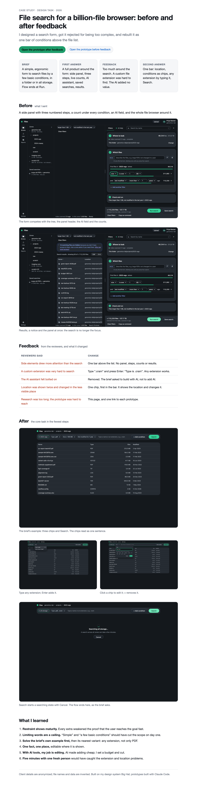

# File search for a billion-file browser: before and after feedback

A design task, rebuilt after the reviewers' feedback. Client details are anonymized; all data is invented.

**▶ Open the clickable case study: https://konstancja-tanjga.github.io/file-search-case/**
Prototypes: [after feedback](https://konstancja-tanjga.github.io/file-search-case/after.html) · [before feedback](https://konstancja-tanjga.github.io/file-search-case/before.html)

<b>Preview of the case study page</b> (click to expand)

## The brief

Design a simple, ergonomic form to find files by a few basic conditions, in one folder or in all storage.
Show how users add, edit and remove conditions. The flow ends when the user runs the search.

## Use case 1 · the brief's example

> Find all PDF files larger than 100 MB that have not been modified for a year, in the current folder.

| | Before feedback | After feedback |
| --- | --- | --- |
| Start | Open *Filters*: a side panel with three numbered steps opens; the file list steps aside | The search bar is already above the file list |
| Location | Shown in the tree, the toolbar, a text line and step 1; changed with a small *Change* link | One chip, first in the bar: *In 2023-wgs ▾* |
| Conditions | Add a line per filter; each line shows a live file count and a progress bar | *+ Add condition*, fill a small editor; each condition becomes a chip |
| Check | A readback sentence in step 3 and an estimate in the footer | The chips read as one sentence: *In 2023-wgs · Type .pdf · Size > 100 MB · Not modified for 1 year* |
| Run | *Run search* in the footer, next to *Save search* and two links | *Search*, the only primary button |
| Around it | AI assistant, dictation, saved searches, notices, status bar | Breadcrumb and the file list, nothing else |

## Use case 2 · a custom extension

> Find all `.cram` files.

| | Before feedback | After feedback |
| --- | --- | --- |
| Steps | *File type* offers fixed categories (PDF, Image, Archive…) with no `.cram`. The user has to know to use *Name ends with* `.cram` | Type `.cram` in the bar, Enter adds *Type is .cram*, Enter again searches |
| Result | Most people stop here | Any extension works; several fit in one chip: `pdf, cram` |

## Feedback → change

| Reviewers said | Change |
| --- | --- |
| Side elements drew more attention than the search | One bar above the list; no panel, steps, counts or results |
| A custom extension was very hard to search | Free text: any extension, typed or picked |
| The AI assistant felt bolted on | Removed; the brief asked to build *with* AI tools, not to add AI |
| Location was shown twice and changed in the less visible place | One chip that shows and changes it |
| Research was too long; the prototype was hard to reach | One case page and one link per prototype |

## What I learned

1. Restraint shows maturity. Every extra weakens the proof that the user reaches the goal fast.
2. Limiting words in a brief ("simple", "a few basic") are a ceiling, not a starting point.
3. Solve the brief's own example first, then its nearest variant.
4. One fact, one place, editable where it is shown.
5. With AI tools, my job is editing: set a budget, then cut.
6. Five minutes with one fresh person catches what three reviews miss.

## Built with

My design system **Big Hat** (`@bighat/ui` CSS inlined in the prototypes) · prototypes built with **Claude Code**.
